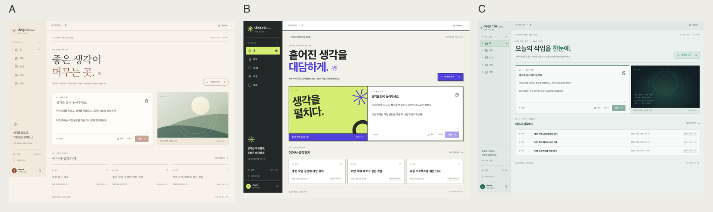

# 세 테마의 개성 강화

작성일: 2026년 10월 30일

색상과 홈 그래픽 중심이던 테마 차이를 제목 서체, 화면 밀도, 탐색 메뉴, 카드의 선과 그림자, 홈 구성으로 확장했다. 설정의 A B C 선택과 라이트·다크 독립 선택은 유지한다.

| 테마 | 시각적 방향 | 실제 반영 |
| --- | --- | --- |
| A 편집 디자인 | 종이 위의 개인 저널 | 아이보리·적갈색·세이지, 명조 제목, 넓은 여백, 이중 구분선, 가벼운 최근 메모, 윤곽선 버튼 |
| B 그래픽 스튜디오 | 대담한 타이포그래피 포스터 | 라임·보라·차콜, 두꺼운 제목과 테두리, 어긋난 그림자, 좌측 그래픽과 우측 기록의 비대칭 구성, 모바일 라임 선택 메뉴 |
| C 작업 콘솔 | 정밀하고 집중된 작업 화면 | 미세 격자, 번호 탐색, 민트 강조, 좁은 사이드바와 상단 바, 이어진 메모 패널, 행으로 정렬한 최근 메모 |

홈의 제목·설명과 사이드바 문구도 각 성격에 맞게 달라진다. 설정의 작은 미리보기는 테마별 구성과 선택한 밝기를 함께 반영한다. 화면 장식이 실제 작업 상태로 오해되지 않도록 가상의 통계나 연결 상태는 추가하지 않았다.



## 적용 구조

팔레트와 곡률, 제목·메타 서체 토큰은 [themes.js](../../src/features/appearance/lib/themes.js), 테마별 구성은 [theme-character.css](../../src/app/styles/theme-character.css)를 기준으로 한다. 기존 공통 구성과 기능 컴포넌트는 공유한다. 테마 전환 시 스타일이 남지 않도록 모든 규칙을 현재 디자인 속성에 한정했다.

A의 제목은 설치된 명조 서체와 serif 대체 서체를 사용한다. 본문과 입력은 한국어 시스템 고딕을 유지하고 추가 웹폰트를 다운로드하지 않는다. 따라서 실제 기기의 명조 모양은 운영체제에 따라 달라질 수 있다.

데스크톱 B는 장식 그래픽을 왼쪽에 배치하고, 모바일에서는 입력을 먼저 제공한다. C의 높은 정보 밀도는 데스크톱 패널과 메타 정보에 적용하며 모바일 터치 영역은 유지한다. 기존 작업 보호, 한글화, 데이터·API 계약은 변경하지 않았다.

## 검증

- lint, 단위 테스트 31개, 한글 문구 검사, 운영 빌드 통과.
- 브라우저 검증 결과는 [검사 기록](browser-checks.json)에 저장했다. 샘플 API 응답을 사용하며 서비스 워커를 우회하는 개발 화면 검사다.
- 6개 테마 × 7개 주요 화면 × 360·390·720·721·768·1024·1025·1440px를 대상으로 총 336개 조합을 검사해 가로 넘침·실행 오류 없이 통과했다. 720px와 1024px 전환점 전후를 포함한다.
- 같은 실행에서 기존 저장·실패 복구·모달·파일 이동·한글 조합·동작 줄이기 13개 상호작용을 재검증해 통과했다.
- [선택·복원 검사](theme-switch-checks.json)에서 6개 테마의 디자인·밝기 독립 저장과 새로고침 후 복원, 실제 사이드바 폭과 제목 서체를 확인했다.
- 마지막 모바일 한글 줄바꿈 조정 후 [12개 홈 조합](mobile-copy-checks.json)을 추가 검사했다.
- 본문·보조 문구·기본 버튼·내비게이션의 팔레트 대비 검사는 6개 조합 모두 통과했다. 캡처는 같은 폴더에 보관한다.

재현 시 개발 서버를 실행한 뒤 Puppeteer Core 모듈 경로를 PUPPETEER_MODULE에 지정하고 아래 명령을 사용한다.

```sh
REVIEW_BASE=http://127.0.0.1:5177 \
REVIEW_OUTPUT=docs/theme-character-2026-10-30 \
REVIEW_WIDTHS=360,390,720,721,768,1024,1025,1440 \
node scripts/verify-workspace.mjs
```

실제 Android·iOS, 스크린 리더와 실제 계정 검수는 기존 잔여 과업으로 유지한다. 브라우저 너비 검사와 실제 기기 검수를 구분한다.
